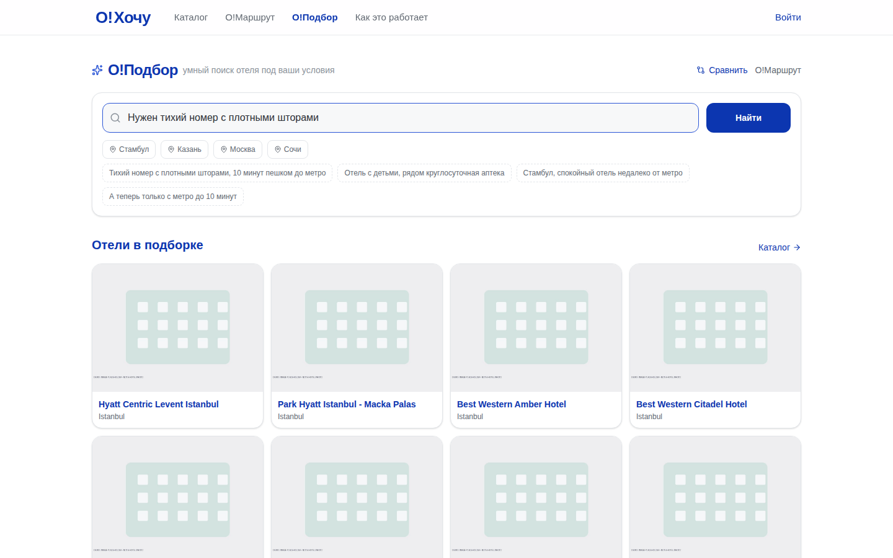
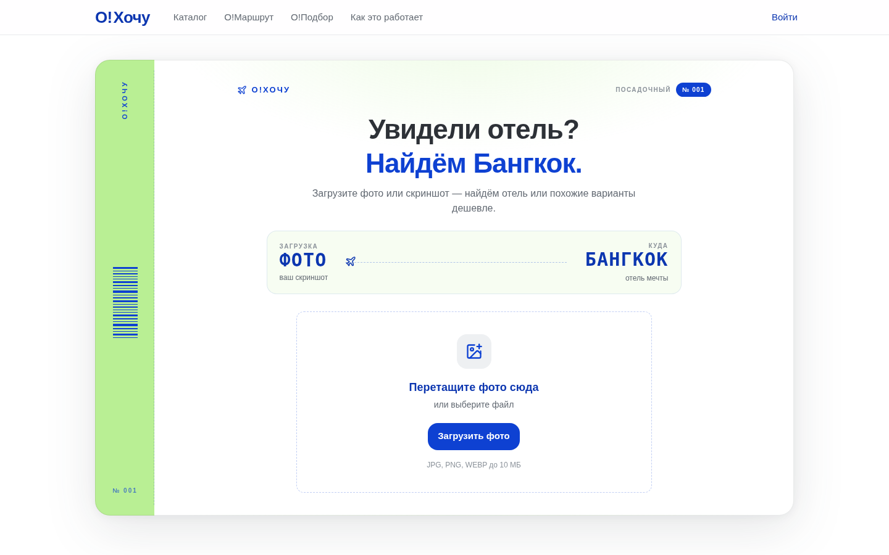
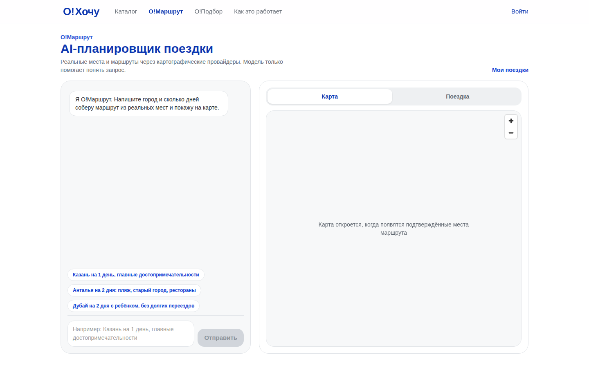
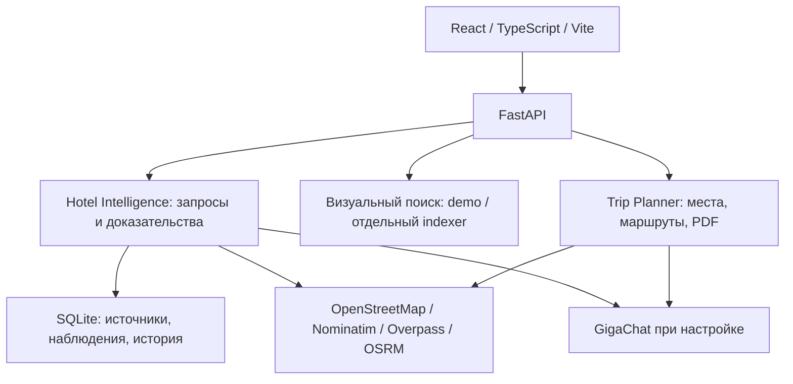

# Vera Labs · О!Подбор / О!Хочу / О!Маршрут

TravelTech-проект хакатона Островка «О!дин шаг до идеального отеля». Подбор отеля по пожеланиям, поиск по изображению и планирование поездки в одном интерфейсе.

[](https://github.com/judogaaa/vera-labs-traveltech/actions/workflows/ci.yml)



## Три сценария

| Модуль | Что делает |
|---|---|
| **О!Подбор** | Разбирает пожелания, сопоставляет характеристики отелей, показывает совпадения, отсутствующие сведения, источники, уверенность и свежесть; сравнение и карта |
| **О!Хочу** | Загрузка фотографии или выделение фрагмента, экран совпадений и альтернатив, выбор номера и демонстрация оформления |
| **О!Маршрут** | Пожелания к поездке, места и переезды на карте, уточнения в диалоге, сохранение маршрута и экспорт PDF-путеводителя |

Например, запрос «тихий номер, метро до десяти минут, плотные шторы» превращается в набор проверяемых условий. Отсутствие сведений не считается подтверждением. Ответ отельера в демо моделируется и не выдаётся за реальную проверку.

| О!Хочу | О!Маршрут |
|:---:|:---:|
|  |  |

Снимки получены Playwright в CI с изолированным API и безопасным каталогом. На экране планировщика показано начальное состояние, без готового маршрута.

## Архитектура



В публичном демо — основные сведения о **25 отелях Стамбула**, 150 географических наблюдений и дополнительная карточка для проверки оформления. В реестре — восемь базовых характеристик; он расширяется определениями. Геоданные содержат оценки и даты, а не гарантии качества проживания. Старые наблюдения могут быть просрочены.

Изображения в публичном каталоге заменены собственными явно подписанными заглушками: права на исходные гостиничные фотографии не подтверждены. Они не являются фотографиями отелей. Распознавание неизвестного отеля по ним не проверяется.

## Запуск локального демо

Нужны Python 3.11–3.12 и Node.js 22. Секреты для базового запуска не нужны.

```bash
python -m venv .venv
# Linux/macOS: source .venv/bin/activate
# Windows PowerShell: .venv\Scripts\Activate.ps1
python -m pip install -r services/search_api/requirements.txt
# Скопируйте .env.example в .env.
npm ci
python -m services.catalog.import_curated_hotels
python -m services.hotel_intelligence.bootstrap
python -m uvicorn services.search_api.main:app --host 127.0.0.1 --port 8000
```

В другом терминале: `npm run dev`. Открыть `http://127.0.0.1:5173`, затем `/hotel-intelligence` или `/oh-route`.

Для изменений характеристик включите `HOTEL_INTELLIGENCE_DEMO_MODE=1` только локально и создайте собственный `HOTEL_INTELLIGENCE_WRITE_TOKEN`: `python -c "import secrets; print(secrets.token_urlsafe(48))"`. Токен остаётся на сервере, без префикса `VITE_`.

## Режимы ИИ

- `SEARCH_BACKEND=mock` — локальный демонстрационный поток; это **не обученная модель идентификации отелей**.
- Облачный визуальный поиск требует отдельно предоставляемого `indexer`, Qdrant, индекса и разрешённых моделей. Этот компонент и веса не входят в публичную поставку; один API-ключ не делает режим рабочим.
- GigaChat подключается серверными переменными `GIGACHAT_*`; нужен собственный доступ. Ключи в браузер не передаются.
- О!Маршрут использует открытые геосервисы; без сети доступны только явно включённые тестовые фикстуры. Доступность, квоты и актуальность внешних данных не гарантированы.

## Проверки

```bash
python -m pip install pytest
python -m pytest -q services
npm run lint
npm test
npm run build
npx playwright install chromium
npm run test:e2e:smoke
```

Полная браузерная команда: `npm run test:e2e`; некоторые сценарии требуют работающего API, геосервисов или настроенного GigaChat. [Результаты и границы проверки](docs/VALIDATION.md).

## Материалы

[Архитектура планировщика](docs/TRIP_PLANNER_ARCHITECTURE.md) · [Сценарий демо](docs/OSTROVOK_DEMO.md) · [Содержание оригинальной презентации](docs/PRESENTATION_OVERVIEW.md) · [Источники и права](THIRD_PARTY.md) · [Безопасность](SECURITY.md)

Оригинальная 16-слайдовая презентация использована для структуры описания. PDF сохранён без изменений у владельца, но не включён в публичный репозиторий: разрешения на встроенные сторонние фотографии не установлены.

Независимый хакатон-прототип, не официальный сервис Островка. **Реальных бронирований и платежей нет**; авторизация и оформление демонстрационные. Исходники доступны для изучения по [LICENSE](LICENSE), это source-available публикация с отдельными условиями для сторонних компонентов.

## Уточнения по безопасности публичного демо

- Для формирования PDF сервер загружает изображения только с доверенных доменов Wikimedia; сторонние ссылки из OSM не скачиваются сервером.
- Ответ `/ready` не раскрывает локальные пути к файлам или текст внутренних исключений.
- Генерируемые идентификаторы новых маршрутов используют полный UUID4. При этом API маршрутов **по-прежнему не имеет полноценной авторизации**: хранить в демо личные планы путешествий и публиковать API на внешнем адресе не следует.
